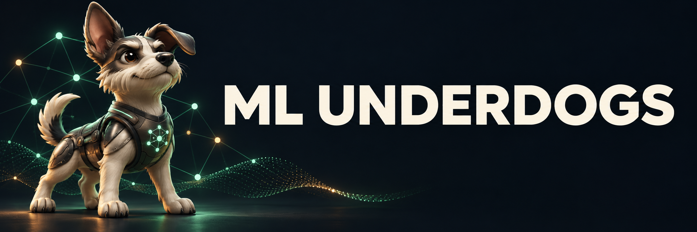

# ML Underdogs

A shared repository for our group's machine learning assignments.

Everyone is welcome to contribute code, improve the documentation,
edit the README, and suggest ways to organise our work.

## Repository structure

- Keep each assignment in its own folder, such as `Assignment2/`.
- Within each assignment, use clearly named folders for individual drafts.
- Include a README with instructions for running your code and a summary
  of your methods and validation results.
- Agree as a group on where to keep the final submission version.

## Working together

- Create a branch for your changes, such as `fikri/assignment2`.
- Open a pull request when your changes are ready to share.
- Ask another group member to review before merging into `main`.
- Check that notebooks run from start to finish in a fresh kernel.
- Discuss changes to another person's draft before editing it.
- Use clear commit messages describing what changed.

## Discussion

Use issues and pull request comments to discuss methods, results,
questions, and improvements.

These are proposed guidelines. We can update them together as needed.